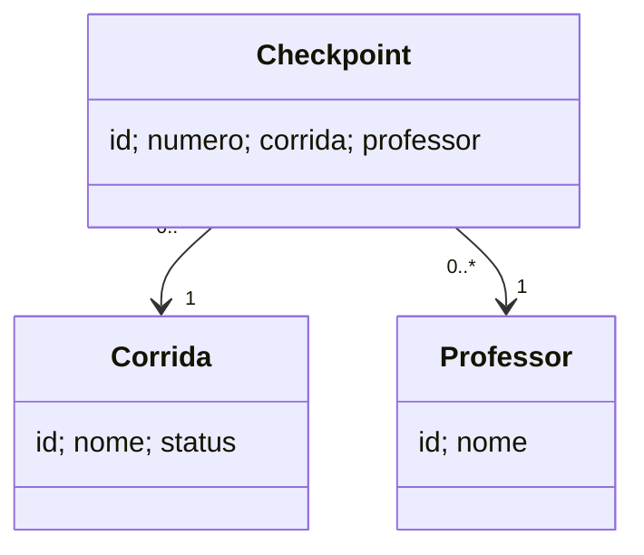
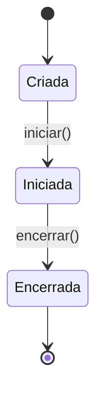

# Sistema de Controle de Checkpoints em Corridas de Trekking

Atividade 1 (Análise, Modelagem, Prototipação e Primeira Implementação) da disciplina Programação Orientada a Serviços — Estudo de Caso 3: Controle de Checkpoints em Corridas de Trekking.

A documentação completa (introdução, requisitos, diagrama de casos de uso, DER e protótipo visual) está em [`docs/relatorio.pdf`](docs/relatorio.pdf).

## Modelo de dados (DER)

- **Corrida** — `id_corrida`, `nome`
- **Professor** — `id_professor`, `nome`
- **Checkpoint** — `id_checkpoint`, `numero`, `id_corrida` (FK), `id_professor` (FK)
- **Equipe** — `id_equipe`, `nome`
- **Passagem** — `id_passagem`, `momento`, `id_corrida` (FK), `id_checkpoint` (FK), `id_equipe` (FK)

O DDL correspondente está em [`schema.sql`](schema.sql).

## Primeira versão da API

Implementada em **Flask + SQLite** (`sqlite3` da biblioteca padrão, sem ORM). O banco (`banco.db`) é criado/atualizado automaticamente na inicialização.

Conforme o escopo desta etapa, **não há** autenticação, validação de entrada ou tratamento elaborado de erros — apenas as operações básicas sobre as tabelas do DER.

### Executando

```bash
python -m venv venv
venv\Scripts\activate        # Windows
# source venv/bin/activate   # Linux/Mac

pip install -r requirements.txt
python app.py
```

A API e a interface sobem em `http://127.0.0.1:5000`. Na v3 a interface não consome a API (usa `localStorage`); o Flask só serve os arquivos estáticos, já que módulos ES não carregam via `file://`.

### Endpoints

| Recurso | Rota | Métodos |
| --- | --- | --- |
| Professores | `/professores` | `GET`, `POST` |
| | `/professores/<id>` | `GET`, `PUT`, `DELETE` |
| Corridas | `/corridas` | `GET` (inclui `total_checkpoints` e `total_passagens`), `POST` |
| | `/corridas/<id>` | `GET` (com checkpoints e passagens), `PUT`, `DELETE` (retorna `409` se a corrida tiver checkpoints ou passagens) |
| Checkpoints | `/corridas/<id_corrida>/checkpoints` | `GET`, `POST` |
| | `/checkpoints/<id>` | `GET`, `PUT`, `DELETE` |
| Equipes | `/equipes` | `GET`, `POST` |
| | `/equipes/<id>` | `GET`, `PUT`, `DELETE` |
| | `/equipes/<id>/historico` | `GET` — histórico de passagens (RF06) |
| Passagens | `/passagens` (aceita `?id_corrida=`) | `GET`, `POST` |
| | `/passagens/<id>` | `GET`, `DELETE` |

`POST /passagens` recebe `id_corrida`, `id_checkpoint` e `id_equipe`; o campo `momento` é preenchido automaticamente pelo servidor (RF04).

### Exemplo de uso

```bash
curl -X POST http://127.0.0.1:5000/professores -H "Content-Type: application/json" -d "{\"nome\":\"Prof. Ana\"}"
curl -X POST http://127.0.0.1:5000/corridas -H "Content-Type: application/json" -d "{\"nome\":\"Trilha da Serra\"}"
curl -X POST http://127.0.0.1:5000/corridas/1/checkpoints -H "Content-Type: application/json" -d "{\"numero\":1,\"id_professor\":1}"
curl -X POST http://127.0.0.1:5000/equipes -H "Content-Type: application/json" -d "{\"nome\":\"Equipe Aventura\"}"
curl -X POST http://127.0.0.1:5000/passagens -H "Content-Type: application/json" -d "{\"id_corrida\":1,\"id_checkpoint\":1,\"id_equipe\":1}"
curl http://127.0.0.1:5000/corridas/1
curl http://127.0.0.1:5000/equipes/1/historico
```

## Interface web

CRUD de **Corrida**, **Professor** e **Checkpoint** em HTML, CSS e JavaScript (módulos ES), com dados no `localStorage`. Para executar: `python app.py` e abrir `http://127.0.0.1:5000/`.

```
frontend/
├── index.html / corridas.html / professores.html / checkpoints.html
├── css/estilo.css
└── js/
    ├── corridas.js, professores.js, checkpoints.js   pontos de entrada das páginas
    ├── classes/     Corrida.js, Professor.js, Checkpoint.js
    ├── dados/       corridas.js, professores.js, checkpoints.js   (localStorage)
    └── interface/   componentes.js                                 (construção dos elementos HTML)
                     corridas.js, professores.js, checkpoints.js   (listas, formulários, eventos)
```

### Módulo de componentes (Frontend v.4)

As classes do domínio deixaram de construir HTML: toda a criação de elementos foi transferida para [`frontend/js/interface/componentes.js`](frontend/js/interface/componentes.js).

**Métodos de renderização identificados e removidos**

| Classe | Método removido | O que apresentava |
| --- | --- | --- |
| `Corrida` | `render(totalCheckpoints)` | Nome, status (selo colorido), total de checkpoints e botões Iniciar/Encerrar (conforme o status), Alterar e Excluir |
| `Professor` | `render(totalCheckpoints)` | Nome, total de checkpoints sob responsabilidade e botões Alterar e Excluir |
| `Checkpoint` | `render()` | Número, corrida, professor responsável e botões Alterar e Excluir |

Além disso, `interface/checkpoints.js` montava as `<option>` dos selects (`preencherSelect`) e as três listas montavam o parágrafo de "lista vazia"; esse código também foi para os componentes.

As classes ficaram só com atributos, construtor, getters/setters e regras de comportamento (por exemplo `iniciar()`, `encerrar()` e `aceitaCheckpoints` em `Corrida`). Nenhuma delas referencia `document`.

**Componentes criados** (todos retornam o elemento criado; quem chama decide onde inseri-lo)

| Função | Recebe | Retorna |
| --- | --- | --- |
| `criarItemCorrida(corrida, totalCheckpoints, { aoIniciar, aoEncerrar, aoAlterar, aoExcluir })` | corrida, total de checkpoints e callbacks | cartão `.corrida`; mostra só as ações compatíveis com o status |
| `criarItemProfessor(professor, totalCheckpoints, { aoAlterar, aoExcluir })` | professor, total e callbacks | cartão `.professor` |
| `criarItemCheckpoint(checkpoint, { aoAlterar, aoExcluir })` | checkpoint e callbacks | cartão `.checkpoint` |
| `criarOpcoes(textoInicial, itens)` | texto inicial e lista de itens com `id` e `nome` | lista de `<option>` (a primeira, desabilitada, é o texto inicial) |
| `criarMensagemVazia(texto)` | texto | parágrafo `<p>` da lista vazia |

Os componentes usam `textContent` (nunca `innerHTML` com dados) e não conhecem regras de negócio: ao clicar em um botão apenas chamam o callback recebido, com a entidade como argumento.

**Responsabilidades de cada módulo**

| Módulo | Responsabilidade |
| --- | --- |
| `classes/` | Representar as entidades (atributos, validações e comportamento), sem conhecer HTML |
| `dados/` | Manter as listas em memória e persistir/recuperar no `localStorage` |
| `interface/componentes.js` | Transformar os dados das entidades em elementos HTML |
| `interface/corridas.js`, `professores.js`, `checkpoints.js` | Regras das operações (criar, alterar, excluir, transições de status), formulários e eventos; usam os componentes para exibir as listas (`renderizarCorridas`, `renderizarProfessores`, `renderizarCheckpoints`) |
| `corridas.js`, `professores.js`, `checkpoints.js` (raiz de `js/`) | Ponto de entrada de cada página |



### Persistência

Chaves: `corridas`, `professores` e `checkpoints`. Em memória o `Checkpoint` referencia objetos `Corrida` e `Professor`; no `localStorage` guarda só os ids:

```json
[{"id":1,"numero":1,"corridaId":1,"professorId":2}]
```

Na carga, corridas e professores são lidos primeiro; depois os checkpoints, que recuperam suas referências pelos ids. Os ids são preservados e `proximoId` é ajustado com `Math.max`.

A corrida também guarda o `status`; corridas salvas antes dessa versão (sem o campo) voltam como `Criada`:

```json
[{"id":1,"nome":"Trilha da Serra","status":"Iniciada"}]
```

### Ciclo de vida da corrida

Cada corrida tem um `status`: `Criada`, `Iniciada` ou `Encerrada`.



- A classe `Corrida` concentra a regra: `iniciar()` só funciona em corridas `Criada` e `encerrar()` só em corridas `Iniciada`; qualquer outra transição lança um erro e não altera o status. O getter `aceitaCheckpoints` informa se a corrida está `Iniciada`.
- A listagem de corridas mostra o status e oferece só a ação compatível: **Iniciar** (corrida `Criada`) ou **Encerrar** (corrida `Iniciada`, com confirmação). Corrida `Encerrada` não tem nenhuma das duas.
- O registro de checkpoints só é aceito em corridas `Iniciada`. A verificação está em `criarCheckpoint` e em `alterarCheckpoint` (mover um checkpoint para outra corrida equivale a registrá-lo nela), em `interface/checkpoints.js`, e não só no formulário: mesmo que a opção de uma corrida `Criada` ou `Encerrada` seja forçada no formulário, a operação é recusada com mensagem.
- Encerrar uma corrida não apaga nada: os checkpoints já registrados permanecem.
- O status é salvo no `localStorage` a cada transição e mantido após recarregar a página.

### Regras de integridade

- Corrida ou professor com checkpoints não pode ser excluído (é exibida uma mensagem).
- O número de um checkpoint não pode se repetir dentro da mesma corrida.
- Novos checkpoints só podem ser registrados em corridas `Iniciada`.
- O status só avança na sequência `Criada → Iniciada → Encerrada`.

### Como testar

1. Cadastre algumas corridas e professores. As corridas nascem como `Criada`.
2. Em Checkpoints, clique em "Novo checkpoint": é exibida a mensagem de que não há corrida iniciada.
3. Em Corridas, clique em **Iniciar** em uma corrida; o status muda para `Iniciada` e o botão passa a ser **Encerrar**.
4. Cadastre um checkpoint selecionando a corrida iniciada e o professor.
5. Recarregue a página e verifique que os dados, as relações e o status continuam exibidos.
6. Clique em **Encerrar** (e confirme): o status vira `Encerrada`, os botões Iniciar/Encerrar somem e os checkpoints já registrados continuam na página Checkpoints.
7. Tente registrar outro checkpoint: a corrida encerrada não aparece na lista e, se for forçada, a operação é recusada.
8. Altere e exclua registros.
9. Tente excluir uma corrida ou um professor que tenha checkpoints e veja a mensagem de bloqueio.

### Onde cada capítulo foi aplicado

| Capítulo | Conceito | Onde está |
| --- | --- | --- |
| Cap. 1 — JavaScript na página web | Criação de elementos com `createElement`/`textContent` e inserção no DOM | `interface/componentes.js` (antes, `render()` das classes) |
| Cap. 2 — Objetos e classes | Classes com atributos privados, getters/setters e métodos de comportamento; exemplo de herança (`CorridaEmAndamento`) na branch `frontend-v2` | `classes/` |
| Cap. 3 — Eventos e interação | Eventos, formulários em `<dialog>`, botões com `data-acao`, `dataset` | `interface/` + páginas `.html` |
| Cap. 4 — Módulos | `import`/`export`, separação classes/dados/interface e pontos de entrada por página | toda a pasta `js/` |
| Cap. 5 — Recursos relacionados e localStorage | Recursos relacionados, referências entre objetos, `localStorage`, reconstrução de objetos e relações, integridade | `classes/Checkpoint.js`, `dados/`, `interface/checkpoints.js` |
| Frontend v.4 — Módulo de componentes | Separação entre domínio e apresentação: funções que constroem os elementos e recebem callbacks | `interface/componentes.js` |
